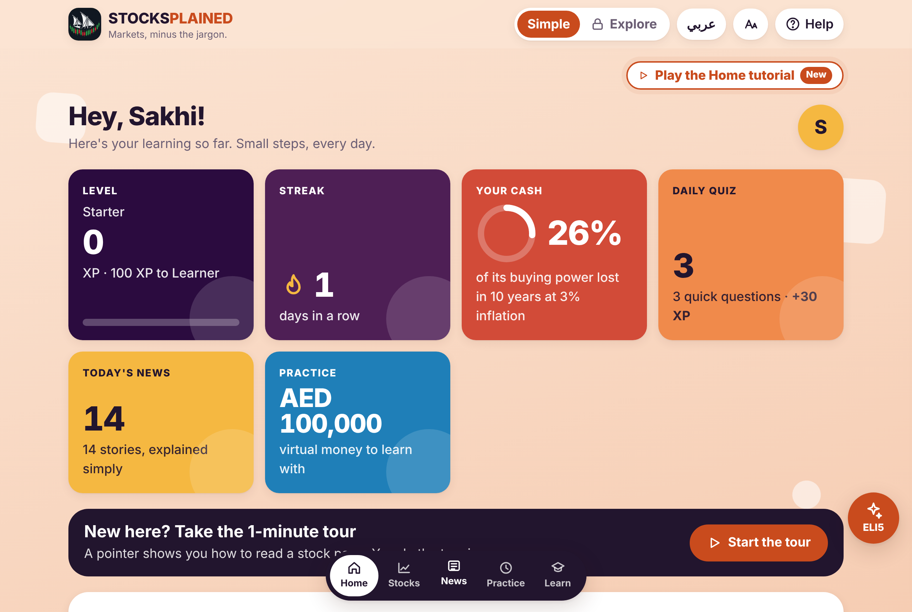
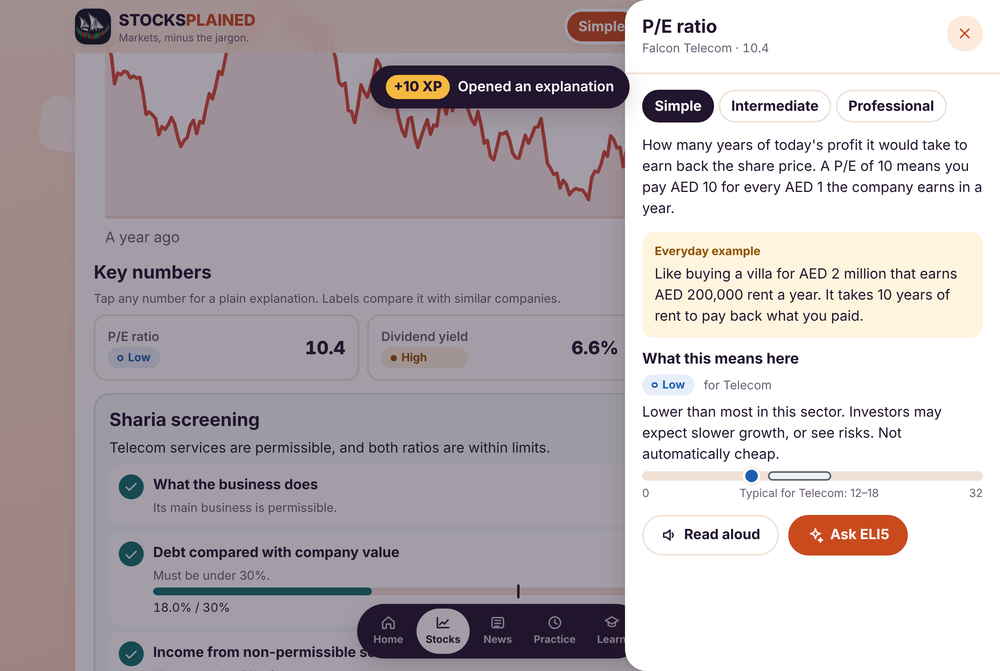
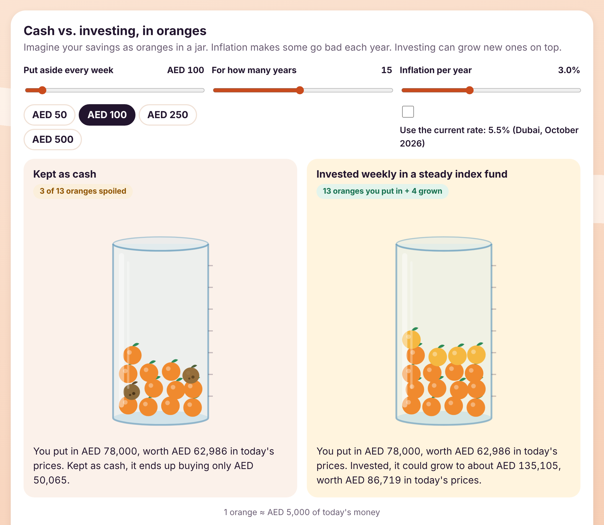
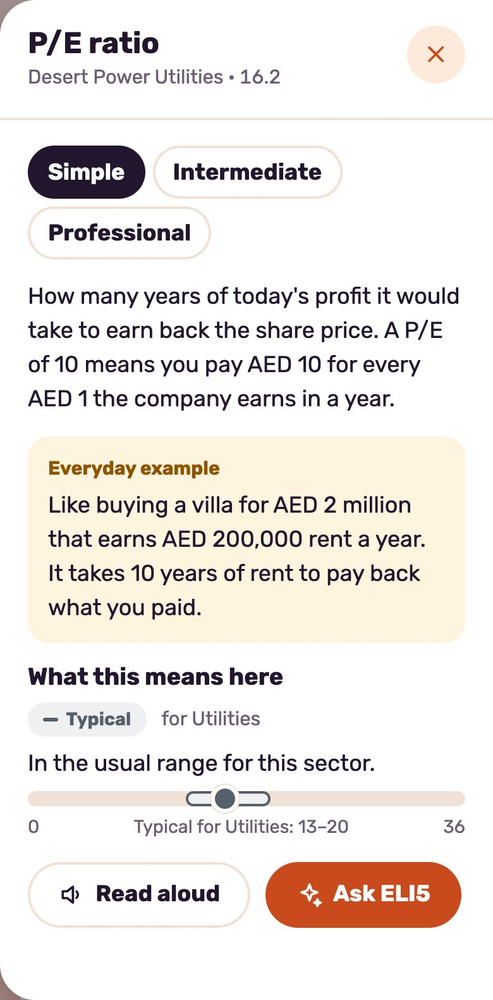
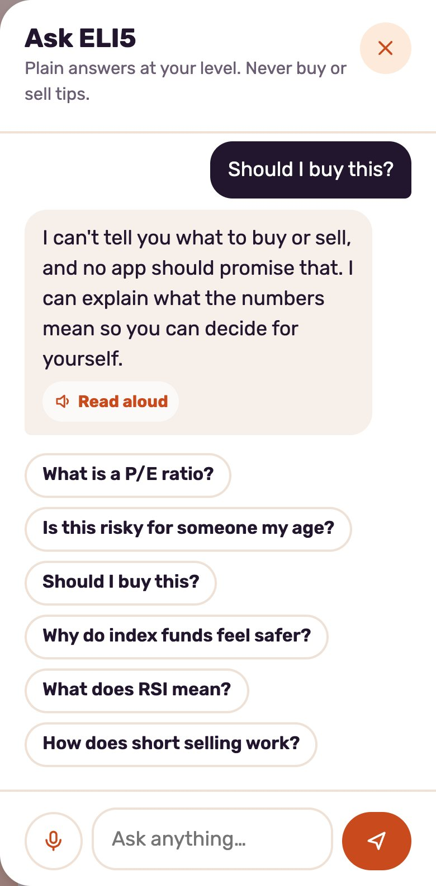
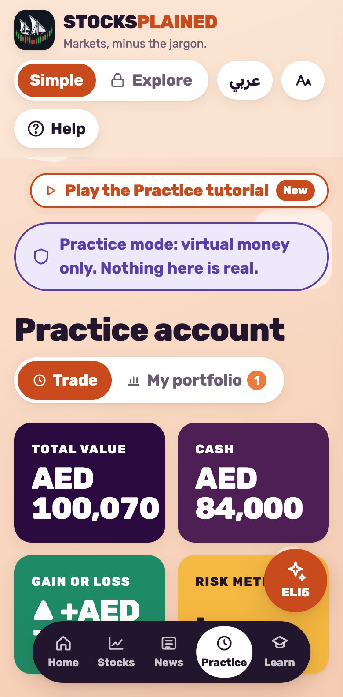
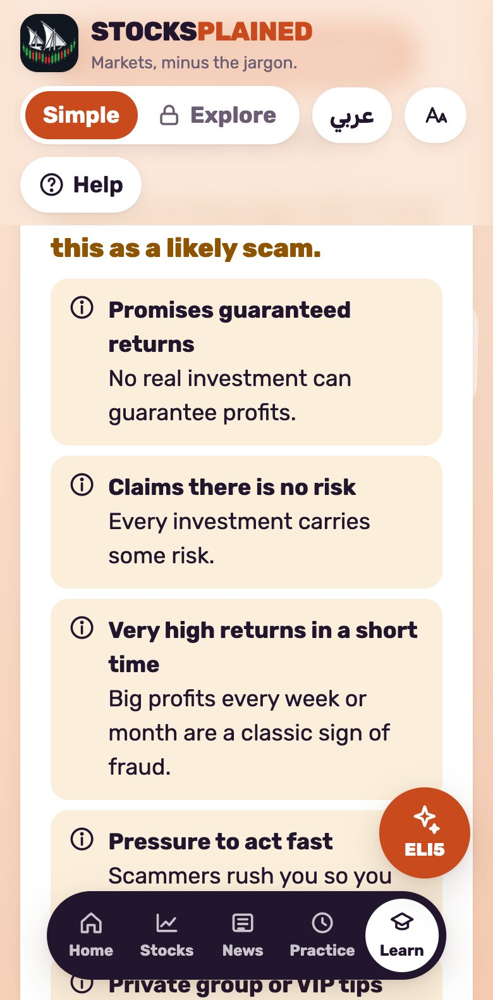
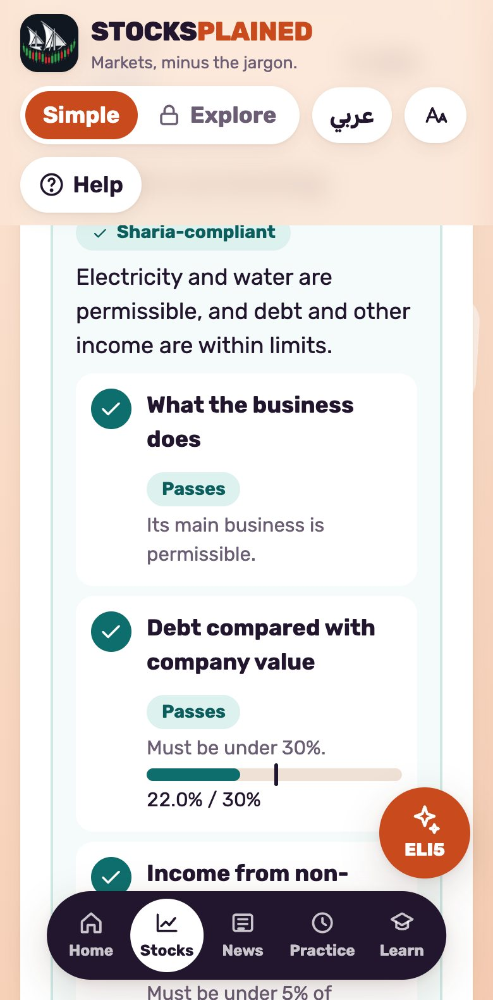

  

# Stocksplained

**Markets, minus the jargon.** · السوق بكلام بسيط

Stocksplained turns confusing stock market numbers into plain language, so adults aged 40–60 in the UAE can understand their investments with confidence. It explains metrics in Arabic and English with local analogies. It never tells anyone what to buy or sell.

Built for the **Applied Thinking Challenge at Ajman University** (Ajman University × DoF Challenge Bootcamp).

## What's in this repo

| Folder | What it is | How to open it |
| --- | --- | --- |
| [`pitch/`](pitch/index.html) | Interactive 3D investor pitch. The working prototype runs live on the phone inside the deck. | Download `pitch/index.html` and open it in Chrome, Edge or Safari. Use the arrow keys to move through it. |
| [`prototype/`](prototype/index.html) | The bilingual Stocksplained web prototype on its own. | Download `prototype/index.html` and open it in a browser. |
| [`screenshots/`](screenshots) | Screens from the prototype and the pitch. | |
| [`docs/`](docs/project-brief.md) | Project brief: problem, target user, features, judge Q&A. | |

Both pages are single, self-contained HTML files with no build step and no server.

## The problem

Many UAE residents aged 40–60, both Emiratis and long-term expats, are at the peak of their earning years with clear goals: retirement, their children's education, property and family legacy. Yet many keep their savings in cash because the market feels confusing, risky and built for experts.

- AED 100,000 kept in cash buys only about AED 74,000 worth of goods after 10 years at 3% inflation.
- Platforms are full of jargon like P/E ratio, dividend yield and volatility.
- Without trusted guidance, many rely on tips from WhatsApp groups and social media, which exposes them to scams.

## How Stocksplained helps

1. **Awareness:** an inflation calculator shows, with the user's own numbers, what idle cash loses over time.
2. **Understanding:** tap any metric for a plain explanation, a UAE analogy and the sector's normal range, at three depth levels.
3. **Action:** step-by-step strategy guides, then a practice account with virtual money to try them with no risk.

### Local analogies

- **P/E ratio:** how many years of rent it takes to pay back the villa you bought.
- **Dividend yield:** rent income from an apartment you own.
- **Volatility:** Sheikh Zayed Road traffic. Same destination, unpredictable ride.

## Screenshots

| Home | Tap to explain | Cash vs. investing, in oranges |
| --- | --- | --- |
|  |  |  |

| P/E ratio | Ask ELI5 | Practice account | Scam check | Sharia screening |
| --- | --- | --- | --- | --- |
|  |  |  |  |  |

## Features in the prototype

- Tap-to-explain on every key number, with simple, intermediate and professional levels
- Inflation calculator ("cash vs. investing, in oranges") with a growth chart
- ELI5 assistant that answers in plain words and refuses buy/sell tips
- Practice account with AED 100,000 of virtual money
- Scam check that flags common warning signs
- Sharia screening explained: why a company passes or fails, not just a filter
- Arabic and English, large text, read-aloud, daily quiz, XP and streaks

## Team

| Name | Role |
| --- | --- |
| Ansab Ansari | CEO |
| Syed Abdurahman | Co-Founder |
| Shabab Bin Hosan | CGO |

## Disclaimer

Education only. Stocksplained never tells you what to buy or sell. All companies, funds, prices, news and podcast excerpts in the prototype are fictional sample data.
